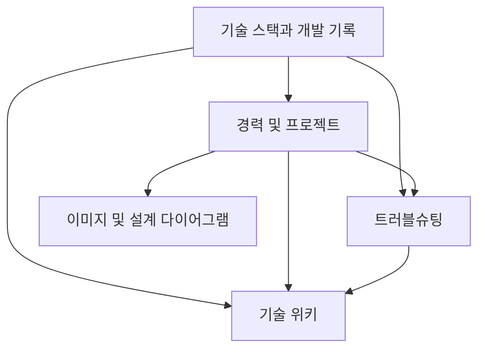

# 기술 스택과 개발 기록

사용하는 기술과 학습 내용, 프로젝트에서의 설계 판단, 문제 해결 과정을 정리하는 개인 기술 저장소입니다.

## 기술 스택

기술별 문서에서 개념, 비교, 장단점, 선택 기준과 적용 경험을 정리합니다. 아래는 정리할 기술 목록이며, 구체적인 사용 경험은 각 문서에 기록합니다.

| 분야 | 기술 및 주제 | 문서 |
| --- | --- | --- |
| 빌드 도구 | Maven, Gradle | [빌드 도구](wiki/build-tools/README.md) |
| 백엔드 | Spring Boot | [Spring Boot](wiki/spring-boot/README.md) |
| .NET | .NET, ASP.NET Core | [.NET](wiki/dotnet/README.md) |
| 메시징 | 메시지 전달, 순서 보장, 재처리 | [메시징](wiki/messaging/README.md) |
| 컨테이너 | Docker | [Docker](wiki/docker/README.md) |
| 데이터베이스 | 모델링, 인덱스, 트랜잭션, 성능 분석 | [데이터베이스](wiki/databases/README.md) |

## 문서 탐색

| 영역 | 내용 | 시작 문서 |
| --- | --- | --- |
| 개발 경력 및 프로젝트 | 경력기술서, 주요 프로젝트, 설계 경험 | [경력 및 프로젝트](portfolio/README.md) |
| 기술 위키 | 개념, 기술 비교, 선택 기준, 실무 적용 | [기술 위키](wiki/README.md) |
| 트러블슈팅 | 증상, 원인 분석, 해결 및 재발 방지 | [트러블슈팅](troubleshooting/README.md) |
| 자료 | 공개 가능한 이미지와 아키텍처 다이어그램 | [자료 안내](assets/README.md) |

## 저장소 구조

```text
engineering-portfolio/
├── README.md
├── CONTRIBUTING.md
├── portfolio/
│   ├── README.md
│   ├── career.md
│   └── projects/
│       └── README.md
├── wiki/
│   ├── README.md
│   ├── build-tools/README.md
│   ├── spring-boot/README.md
│   ├── dotnet/README.md
│   ├── messaging/README.md
│   ├── docker/README.md
│   └── databases/README.md
├── troubleshooting/
│   └── README.md
└── assets/
    ├── README.md
    ├── images/README.md
    └── diagrams/README.md
```

## 문서 연결 방식



위 다이어그램은 저장소 문서의 연결 구조이며, 실제 수행한 프로젝트 아키텍처를 나타내지 않습니다.

## 단계별 확장

1. [경력기술서](portfolio/career.md)에 공개 가능한 경력 정보를 정리합니다.
2. [프로젝트 템플릿](portfolio/projects/README.md)을 복사하여 대표 프로젝트를 작성합니다.
3. 프로젝트에서 사용한 기술과 판단 근거를 [위키](wiki/README.md)에 연결합니다.
4. 확인된 장애 사례를 [트러블슈팅 템플릿](troubleshooting/README.md)으로 기록합니다.
5. 근거, 상대경로 링크, 기밀 포함 여부를 검토한 뒤 문서를 공개합니다.

## 작성 원칙

- 문서는 Markdown으로 작성하고, 저장소 내부 링크는 상대경로를 사용합니다.
- 아키텍처 다이어그램은 Mermaid로 작성합니다.
- 수행 사실, 측정 결과, 개인 해석을 구분합니다.
- 실제 수행하지 않은 업무와 검증되지 않은 성과를 기재하지 않습니다.
- 회사 내부 정보와 고객사 기밀은 제외합니다.
- 기술 선택은 조건과 대안을 함께 설명하고 과장된 표현을 피합니다.

파일명과 작성 절차는 [문서 작성 가이드](CONTRIBUTING.md)를 참고합니다.
