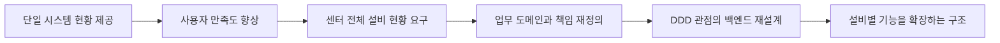

# [architecture] 설비 모니터링 확장에 따른 DDD 기반 백엔드 재설계

현장을 담당하면서 사용자의 설비 현황 조회 요구에 대응해 모니터링을 제공했다. 처음에는 하나의 시스템을 대상으로 가볍게 시작했지만, 제공한 정보에 대한 사용자 만족도가 높아지면서 센터 내 다른 설비의 현황도 보고 싶다는 요구로 확대됐다.

늘어나는 설비와 업무별 요구에 유연하게 대응하기 위해 기존 백엔드 구조를 재정의하고 DDD를 적용해 개선했다.

## 시작 배경

사용자는 현장에서 설비가 어떤 상태인지, 작업이 얼마나 진행됐는지 확인할 정보가 필요했다. 단일 시스템의 현황을 먼저 제공해 현장 사용성을 확인했고, 이후 센터 내 모든 설비의 현황을 통합해서 보여 달라는 요구로 이어졌다.

## 확장 과정의 과제

초기 구조는 한 시스템의 데이터를 조회해 화면에 전달하는 데 초점을 맞췄다. 대상 설비가 늘어나면서 단순히 조회 API를 추가하는 것보다 다음 문제를 다루는 구조가 필요해졌다.

- 설비와 업무마다 다른 데이터 구조와 상태 의미
- 여러 데이터 소스에서 가져오는 정보의 조합
- 특정 설비의 변경이 다른 업무에 미치는 영향
- 조회, 상태 판단, 화면 응답과 캐시 관리의 책임 구분

## 담당 작업과 설계 변경

현장 요구를 반영해 백엔드 설계를 다시 정리했다. 설비 데이터를 하나의 공통 구조에 억지로 맞추기보다 업무 도메인을 기준으로 기능을 나누고, 각 영역에서 조회와 상태 해석을 담당하도록 구성했다.

- 업무 도메인별로 패키지와 기능을 구분했다.
- 각 영역 안에서 Controller, Service, Repository, DTO의 책임을 나눴다.
- 업무별 상태와 분류를 코드에 표현했다.
- 외부 데이터 조회와 화면에 필요한 집계·응답 조합을 구분했다.
- 여러 설비의 현황을 연결하는 지점을 정리했다.

DDD는 설비 수만큼 서비스를 나누는 방식이 아니라, 서로 다른 업무의 의미와 변경 범위를 기준으로 백엔드를 구성하는 데 적용했다. 별도 MSA 전환보다 기존 애플리케이션 안에서 업무별 구조와 책임을 재정의하는 데 집중했다.

## 확장 흐름

## 결과

하나의 시스템에 한정했던 모니터링을 센터 내 여러 설비의 현황을 다루는 통합 대시보드로 확장했다. 사용자 요구가 확대되는 과정에서 업무별 기능과 데이터 접근 책임을 구분해, 추가 설비의 요구를 반영할 구조로 개선했다.

## 관련 문서

- [백엔드 코드 구조](백엔드코드구조.md)
- [설계 판단과 적용 범위](설계판단.md)
- [MSA 설계 기준](../개발협업가이드/MSA설계기준.md)

공개 문서에는 업무별 구조와 설계 판단을 정리했으며 고객사 원본 SQL, 접속 설정과 운영 식별 정보는 포함하지 않는다.

[공개 작업 목록으로](../README.md)
