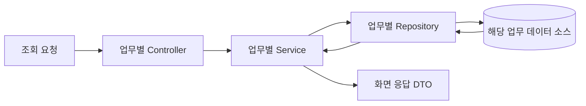

# 업무 도메인별 백엔드 코드 구조

설비 현황을 통합하는 과정에서 업무별 요구와 데이터 소스를 구분하고, 각 영역의 조회·상태 해석·응답을 구성했다.

## 업무별 구성

반송, 수동분류, 재고·설비 상태와 이동 작업 등 업무별 패키지 안에 Controller, Service, Repository와 DTO를 배치했다.

```text
업무 도메인/
├── controller/   요청과 조회 조건 수신
├── service/      조건 정리, 상태 판단, 집계와 응답 조합
├── repository/   외부 데이터 조회와 매핑
├── dto/          조회 결과와 화면 응답
└── domain/       해당 업무의 분류와 의미 표현
```

위 구조는 역할을 설명하는 요약이다. 모든 업무 패키지에 같은 하위 폴더를 강제하지 않는다.

## 조회 흐름



이동 작업 조회에서는 Controller가 조건을 받아 Service에 전달한다. Service는 조회 개수를 기본값과 상한 범위로 정리하고 Repository를 호출한다. Repository는 JdbcTemplate으로 데이터를 읽고 DTO에 매핑한다.

## 상태 판단과 캐시

반송 상태를 제공하는 Service는 최근 데이터를 조회하고 분류 코드를 enum으로 해석한다. 발생 시각과 유효 기간을 기준으로 표시할 값의 유효성을 판단한 뒤 응답 목록을 만들어 캐시를 교체한다.

조회 조건을 다루는 정책과 업무 상태를 해석하는 정책을 구분해 읽을 수 있도록 책임을 정리했다. Controller에 SQL이나 상태 해석을 넣지 않고 각 업무 영역에서 처리한다.

## 여러 업무의 정보 조합

수동분류 화면은 자체 조회 결과와 재고 영역의 캐시를 이용해 대기 작업 정보를 조합한다. 재고 대시보드에서도 설비 영역의 캐시를 참조해 필요한 정보를 구성한다.

통합 대시보드의 특성상 영역 간 정보 조합이 존재한다. 업무별 데이터 조회 책임을 유지하면서 화면에 필요한 정보를 Service에서 조합하는 구조다.

## 코드 분석 기준

기존 대시보드의 로컬 Git 커밋 `c82a9d1ca797fc302bd1270b927c6f80f4262710`에 있는 다음 파일을 기준으로 구조를 정리했다.

| 파일 | 역할 |
| --- | --- |
| `FollowmeOperationController.java` | 조회 조건 수신과 Service 위임 |
| `FollowmeOperationService.java` | 조회 조건 정리와 Repository 호출 |
| `FmOrdersRepository.java` | JdbcTemplate 조회와 DTO 매핑 |
| `RejectType.java` | 업무 분류 코드의 의미 표현 |
| `RejectService.java` | 시간 유효성 판단과 캐시 갱신 |
| `DLS_RejectRepository.java` | 최근 상태 데이터 조회 |
| `ManualSortingService.java` | 수동분류와 재고 정보 조합 |
| `OsrDashboardService.java` | 재고 집계와 설비 상태 정보 조합 |

[작업 설명으로](README.md)
