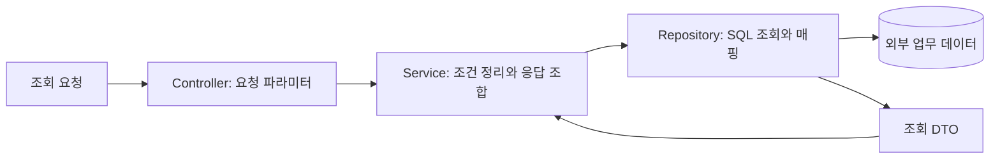

# 실제 대시보드 코드의 구조 분석

## 1. 업무별 패키지

분석한 백엔드는 반송, 수동분류, 재고·설비 상태, 이동 작업 등 업무별 패키지 안에서 조회 기능을 나눈다. 화면에 전달하는 모델은 주로 DTO이고 데이터 접근은 JdbcTemplate 기반 Repository에서 수행한다.

패키지 이름은 업무를 찾는 데 도움이 되지만, 같은 단어의 의미와 모델이 어디까지 유효한지까지 자동으로 정의하지 않는다. 따라서 이를 Bounded Context 후보를 찾는 자료로 사용하고, 이미 독립된 Bounded Context가 확립됐다고 단정하지 않는다.

## 2. 조회 요청의 책임 분리

확인한 이동 작업 조회 경로에서 Controller는 조회 조건을 받아 Service를 호출한다. Service는 조회 개수를 기본값·상한 범위로 정리하고 Repository에 넘긴다. Repository는 SQL을 실행하고 결과를 DTO에 매핑한다.

이 Repository는 확인한 코드에서 구체 클래스이며, Service가 해당 클래스를 직접 주입받는다. 도메인 모델의 저장 계약을 정의한 인터페이스와 인프라 구현이 분리된 사례로 설명하지 않는다. 또한 조회 개수 제한은 업무 불변식이라기보다 조회 사용 사례의 입력 정책으로 보는 편이 자연스럽다.

## 3. 서비스에 함께 있는 책임

반송 상태 서비스에서 확인한 동작:

1. Repository에서 최근 조회 결과를 읽는다.
2. 분류 코드를 enum으로 해석한다.
3. 데이터의 시각과 유효 기간으로 표시할 값의 유효성을 판단한다.
4. 응답 DTO 목록을 만들어 캐시를 교체한다.
5. 조회 요청에는 캐시를 바탕으로 응답한다.

주기 실행, 현재 시각 획득, 유효성 규칙, DTO 변환과 캐시 관리가 한 Service에 모여 있다. 이 중 시간 유효성 판단을 외부 I/O 없는 정책으로 분리할 수 있는지 검토했다.

enum은 코드 값과 의미를 연결하며 알 수 없는 값에는 예외를 던진다. 이것만으로 Entity나 Aggregate를 구현했다고 보지는 않는다.

## 4. 영역 간 직접 참조

수동분류 서비스는 자체 Repository뿐 아니라 재고 영역의 캐시를 직접 주입받는다. 재고 조회 결과를 이용해 대기 작업의 화면 상태를 조합한다. 재고 대시보드 서비스에서도 다른 설비 영역의 캐시를 참조하는 코드가 보인다.

따라서 현재 코드는 업무 패키지가 나뉘어 있어도 영역 사이에 직접적인 코드 의존성이 있다. 개선하려면 다음 질문에 답해야 한다.

- 소비하는 화면이 실제로 필요한 데이터는 무엇인가?
- 데이터 소유 영역과 화면 조합 책임은 어디에 두는가?
- 데이터가 늦거나 조회에 실패한 상태를 어떻게 표현하는가?
- 상태값의 의미가 다른 영역에서도 같은가?

이 질문을 정리하기 전에 패키지를 서비스로 분리하는 것만으로 경계 문제가 해결됐다고 판단하지 않는다.

## 5. DDD 개념별 확인 범위

| 개념 | 코드에서 확인한 범위 |
| --- | --- |
| 업무 언어 | 업무별 패키지·메서드·DTO에 용어가 나타남. 현업과의 용어 합의 문서는 미확인 |
| Bounded Context | 업무별 영역 후보가 있음. 모델 경계와 소유권의 공식 정의는 미확인 |
| Entity / Value Object | 분석 범위에서 행동·불변식을 가진 모델의 사례를 확인했다고 주장하지 않음 |
| Aggregate | 상태 변경과 일관성 경계를 가진 루트 모델은 분석 범위에서 확인하지 않음 |
| Repository | JdbcTemplate 기반 조회 구현 확인. 도메인 계약 인터페이스로의 분리는 미확인 |
| Domain Service | 일반 Service에서 규칙을 발견했지만 이를 독립적인 도메인 서비스 구현으로 단정하지 않음 |
| Domain Event | 분석한 파일에서 발행·처리 구조를 확인하지 않음 |

## 분석 근거

아래 파일명을 기준으로 분석했다. 원본 경로의 고객사 식별 패키지와 실제 코드 내용은 공개하지 않는다.

| 파일 | 확인한 요소 |
| --- | --- |
| `FollowmeOperationController.java` | 조회 조건 수신과 Service 위임 |
| `FollowmeOperationService.java` | 조회 개수 정규화와 Repository 호출 |
| `FmOrdersRepository.java` | JdbcTemplate 기반 조회 및 DTO 매핑 |
| `RejectType.java` | 코드 변환과 미지원 값 처리 |
| `RejectService.java` | 시간 유효성 규칙, 주기 조회와 캐시 교체 |
| `DLS_RejectRepository.java` | 최근 상태 데이터 조회 |
| `ManualSortingService.java` | 다른 업무 영역 캐시를 이용한 응답 조합 |
| `OsrDashboardService.java` | 재고 집계와 설비 영역 캐시 참조 |

서버 실행·DB 연결과 운영 재시험은 수행하지 않았다.

[학습 목록으로](README.md)
