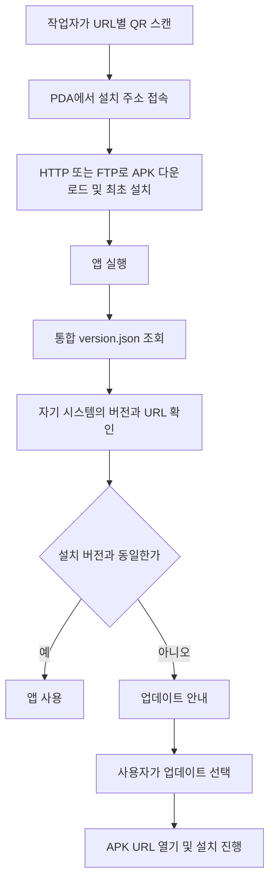

# [android] 폐쇄망 PDA APK 배포·자동 업데이트

폐쇄망 환경에서 PDA 업무 앱의 최초 설치와 이후 버전 업데이트를 지원하는 기능을 구축했다. 복잡한 기술 도입보다는 작업자가 설치 주소를 직접 입력하거나 APK 파일을 별도로 전달받는 과정을 줄이는 데 초점을 뒀다.

## 해결하려던 문제

- 폐쇄망에서 사용할 업무 APK의 배포 경로가 필요했다.
- 작업자가 PDA에서 쉽게 최초 설치 주소로 접속할 수 있어야 했다.
- 설치 후에는 앱에서 배포된 버전을 확인하고 업데이트로 이어질 수 있어야 했다.
- 여러 시스템의 버전과 다운로드 주소를 한 규격으로 관리할 필요가 있었다.

## 구현 내용

- IIS 웹서비스에 시스템별 APK 다운로드 경로를 구성하고 HTTP와 FTP 배포 방식을 모두 지원했다.
- URL별 QR을 제공해 작업자가 PDA로 스캔하고 최초 설치 주소에 접속할 수 있도록 했다.
- 통합 `version.json`으로 시스템별 버전과 APK URL을 관리하도록 했다.
- 앱에서 자기 시스템의 버전을 자동 확인하고, 버전이 다르면 업데이트 안내와 다운로드 URL로 연결하는 흐름을 마련했다.
- 협력사가 같은 규격으로 연동할 수 있도록 JSON 규격, Kotlin 구현 예시와 배포 절차를 문서화했다.

## HTTP·FTP 지원과 운영 조건

| 방식 | 적용 내용 |
| --- | --- |
| HTTP | 웹서비스 URL을 통한 APK 배포 |
| FTP | anonymous 계정 권한을 사용한 APK 배포 |

폐쇄망에서 운영하고 접속 대상 장비를 화이트리스트로 관리하는 환경에 맞춰 FTP anonymous 접근을 사용했다. 작업자는 배포 URL에 대응하는 QR을 통해 최초 설치 경로에 접근하도록 했다.

화이트리스트 관리를 전제로 한 당시 환경의 구성 선택을 기록한 것이다. 화이트리스트 적용 위치, FTP 세부 권한과 전송 모드 등 확인되지 않은 설정은 추가하지 않는다.

첨부 가이드와 Kotlin 예시는 HTTP 계열 URL 및 `HttpURLConnection`을 사용하는 연동 흐름이다. FTP 지원은 실제 구축 경험으로 보완해 기록하며, 해당 예시 코드가 FTP까지 구현한 것으로 설명하지 않는다. 별도 FTP 클라이언트 구현과 서버 설정 원본은 이 저장소에 포함되어 있지 않다.

## 설치와 업데이트 흐름

제공된 가이드에서 확인되는 자동화 범위는 버전 확인과 업데이트 안내다. 사용자의 조작 없이 APK가 설치되는 무인·강제 설치 방식으로 설명하지 않는다.

## 시스템별 관리

| 시스템 키 | 관리 항목 |
| --- | --- |
| `flypick` | 버전 문자열, APK URL |
| `manualsorting` | 버전 문자열, APK URL |
| `followme` | 버전 문자열, APK URL |
| `suresorter` | 버전 문자열, APK URL |

앱은 `systems` 아래에서 자기 시스템 항목을 선택한다. 비교 기준은 버전 문자열의 동일 여부이며, 버전의 크기를 비교하는 정책은 아니다. 서버 버전이 낮더라도 문자열이 다르면 안내 대상이 될 수 있으므로 이를 자동 다운그레이드 기능으로 해석하지 않는다.

## 공개 자료

- [업데이트 서버 가이드 v1.1](업데이트서버가이드.md): 제공된 원문. 통합 JSON, Kotlin 예시, 권한과 운영 절차 포함
- [version.json 예시](version.example.json): 가이드의 최종 예시를 별도 파일로 제공

원문의 시스템명과 예시 URL을 유지했다. `update.your-domain.com`은 가이드의 예시 주소이며 접속 가능한 데모 서버를 제공하는 것은 아니다.

## 배포 절차

1. 시스템별 폴더에 새 APK를 올린다.
2. 통합 JSON의 해당 버전과 다운로드 URL을 변경한다.
3. 앱 실행 시 새 배포 정보를 자동으로 확인한다.
4. 작업자는 안내에 따라 업데이트를 진행한다.

최초 설치 시에는 제공된 QR을 스캔해 해당 설치 주소에 접근한다. 실제 QR 이미지와 운영 APK, IIS 서버 설정 원본, 앱 전체 소스는 이번 공개 자료에 포함되어 있지 않다.

## 결과와 기록 범위

작업자가 QR로 최초 설치 경로에 접속하고 이후 앱에서 업데이트를 확인·진행할 수 있는 편의 기능을 제공했다. 여러 시스템의 업데이트 정보를 통합 JSON 규격으로 정리했다.

이 저장소에는 작업 경험과 제공된 가이드를 정리했다. 등록 과정에서 실제 PDA 설치, QR 스캔, IIS 배포와 앱 업데이트를 재시험하지 않았다. 설치 시간 단축이나 운영 비용 절감에 관한 측정 수치는 기재하지 않는다. Kotlin 코드는 연동 예시이며 빌드 가능한 앱 프로젝트 전체가 아니다.

[공개 작업 목록으로](../README.md)
