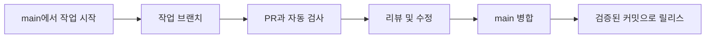

# [doc] 브랜치 전략

> 팀에서 검토할 제안 기준이다. 현재 저장소의 브랜치 보호 설정을 설명하는 문서는 아니다.

## 기본 선택

변경을 자주 통합할 수 있고 자동 검증과 배포 준비가 가능한 팀에서는 `main`과 짧은 작업 브랜치를 기본으로 검토한다.

| 브랜치 예시 | 목적 |
| --- | --- |
| feature/issue-123-topic | 기능 추가 |
| fix/issue-124-topic | 오류 수정 |
| docs/topic | 문서 변경 |
| hotfix/issue-125-topic | 긴급 수정 |

이슈 번호는 실제 추적 체계가 있는 경우에만 사용한다.

## 병합 기준

- 변경의 인수 조건과 검증 결과를 PR에서 확인한다.
- 필요한 리뷰와 자동 검사가 끝난 뒤 병합한다.
- 공유 브랜치 이력을 임의로 다시 쓰지 않는다.
- 장기 작업은 기능 플래그 또는 작은 변경으로 나눌 수 있는지 검토한다.
- 병합 후 브랜치를 삭제할 때 후속 작업이 남아 있는지 확인한다.

리뷰어 수와 병합 방식은 서비스 위험과 팀 규모에 맞춰 정한다. 이 문서는 저장소 설정을 자동으로 변경하지 않는다.

## 별도 릴리스 브랜치가 필요한 경우

여러 운영 버전을 동시에 유지하거나 승인 대기 기간이 긴 경우 릴리스 브랜치를 검토한다. 유지 기간, 패치 반영 방향과 종료 조건을 함께 정한다. 브랜치 수만 늘리고 동기화 책임을 두지 않는 방식은 피한다.

긴급 수정도 테스트와 추적 기록을 남기고, 운영 패치를 개발 기준선에 반영했는지 확인한다.

[가이드 목록으로](README.md)
