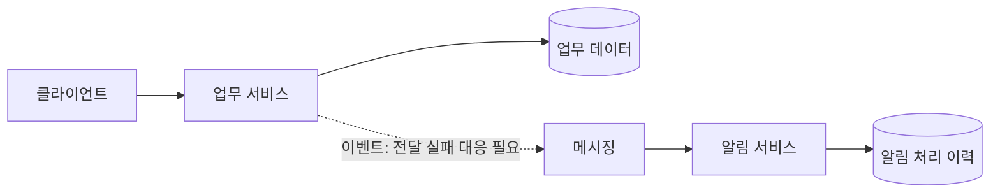

# [architecture] MSA 설계 판단 기준

> MSA를 지향하는 개발 PL 관점의 제안 기준이다. 운영 MSA를 구축했다는 실적이나 완성된 시스템 설계를 뜻하지 않는다.

## 서비스 분리 판단

서비스 수보다 업무 경계와 독립적인 변경 필요를 먼저 확인한다. 경계가 불분명하거나 운영 여력이 부족하면 모듈형 단일 애플리케이션으로 시작하는 대안도 비교한다.

| 판단 항목 | 분리를 검토할 조건 | 추가 검토할 비용 |
| --- | --- | --- |
| 업무 경계 | 책임과 용어가 구분됨 | 경계 변경 시 계약 조정 |
| 배포 | 독립 배포 필요가 반복됨 | 호환성, 배포 순서와 복구 |
| 데이터 | 소유권과 일관성 요구를 설명할 수 있음 | 중복 데이터와 동기화 지연 |
| 확장 | 특정 기능의 부하 특성이 다름 | 측정과 운영 복잡성 |
| 팀 책임 | 운영과 변경 담당이 명확함 | 팀 간 의존성과 장애 조율 |

## 데이터와 연동

- 데이터 변경 책임을 서비스별로 정의하고, 타 서비스 테이블 직접 갱신을 계약으로 삼지 않는다.
- 동기 호출은 응답 대기, 타임아웃과 의존 서비스 장애의 영향을 검토한다.
- 비동기 연동은 중복, 순서, 지연과 재처리를 검토한다. 이벤트를 쓴다는 이유로 정합성이 자동 보장되지는 않는다.
- 재시도는 횟수와 대기 간격을 제한하고, 중복 요청을 안전하게 처리할 방법을 정한다.
- API와 이벤트의 변경은 기존 소비자와 함께 검토한다.

## 구성 예시

아래는 논의용 가상 구성이다. 실제 구축 사례가 아니다.

데이터 저장과 이벤트 발행 사이의 실패를 검토해야 한다. 필요하면 outbox 등의 대안을 ADR로 비교한다. 이 그림은 해당 문제를 해결한 구현을 포함하지 않는다.

## 장애와 운영

서비스별 상태 확인, 추적 식별자, 오류율과 지연을 관찰할 방법을 둔다. 부분 장애에서 중단할 기능과 유지할 기능, 복구 순서를 정한다. 배포 단위가 늘어나는 만큼 접근 제어, 비밀 값 관리와 운영 책임도 확인한다.

## 관련 실제 자료

[MQTT 재현 결과](../mqtt-ha/lab/results.md)는 메시징 인프라의 제한된 실험이다. 이를 서비스 간 데이터 일관성이나 MSA 전체의 검증 결과로 해석하지 않는다.

## 참고

- [Microsoft: 서비스 경계를 위한 도메인 분석](https://learn.microsoft.com/en-us/azure/architecture/microservices/model/domain-analysis)
- [Microsoft: Microservices architecture style](https://learn.microsoft.com/en-us/azure/architecture/guide/architecture-styles/microservices)

[가이드 목록으로](README.md)
