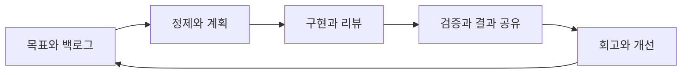

# [agile] 스쿼드 운영 가이드

> 개발 PL 관점에서 재작성한 운영 제안이다. 실제 조직도나 회의 기록을 공개한 자료가 아니다.

## 운영 방향

업무 목표를 중심으로 팀의 책임 범위를 정하고 구현부터 검증·배포 후 확인까지 연결한다. 스쿼드라는 명칭만으로 특정 애자일 프레임워크를 준수한다고 판단하지 않는다.

## 책임 구분 제안

| 책임 | 주요 내용 |
| --- | --- |
| 제품 우선순위 담당 | 목표, 가치, 우선순위와 이해관계자 조율 |
| 개발 PL | 기술 의존성·위험의 가시화, 설계 논의 지원, 전달 흐름 조율 |
| 개발 담당 | 구현 방식 결정, 테스트, 리뷰와 운영 영향 확인 |
| 품질·운영 협업 담당 | 검증 전략, 배포 준비와 운영 관찰 지원 |

역할은 인원 배치와 같지 않다. 조직에 따라 한 사람이 복수 책임을 맡을 수 있다. Scrum을 채택하면 해당 책임 체계와 구분해 합의하고, 개발 PL을 Scrum의 공식 역할로 간주하지 않는다. 구현 작업의 배분과 방법은 팀의 자율성을 존중한다.

## 작업 흐름

- 백로그 정제: 목적, 인수 조건, 의존성과 불확실성을 확인한다.
- 계획: 가용 역량과 목표를 함께 보고, 외부 의존 작업에는 담당자와 확인 시점을 둔다.
- 일일 조율: 개인 실적 보고보다 목표 진행, 막힌 작업과 협업 필요 사항을 다룬다.
- 결과 공유: 계획 대비 산출물과 실제 관찰 결과를 보여주고 다음 우선순위에 반영한다.
- 회고: 개선 항목을 적게 선택해 담당자와 다음 확인 시점을 정한다.

구체적인 반복 주기와 회의 길이는 팀에서 정한다. 위 목록 자체가 Scrum 전체를 정의하지 않는다.

## 위험과 변경 관리

간단한 기록에 위험, 영향, 대응, 담당자와 재검토 시점을 둔다. 범위 변경은 목표와 일정에 미치는 영향을 함께 설명한다. 모든 변경을 PL 승인 대기 상태로 만들기보다 팀이 결정할 범위와 상위 조율이 필요한 조건을 정한다.

## 관찰할 지표

리뷰 대기 시간, 막힌 작업의 기간, 배포 후 결함과 반복되는 재작업을 개선 대화에 사용한다. 측정 정의와 수집 기간을 맞추고, 개인 평가나 팀 간 단순 순위에 사용하지 않는다. 스토리 포인트를 개인 생산성이나 외부 약속의 절대 단위로 사용하지 않는다.

[가이드 목록으로](README.md)
