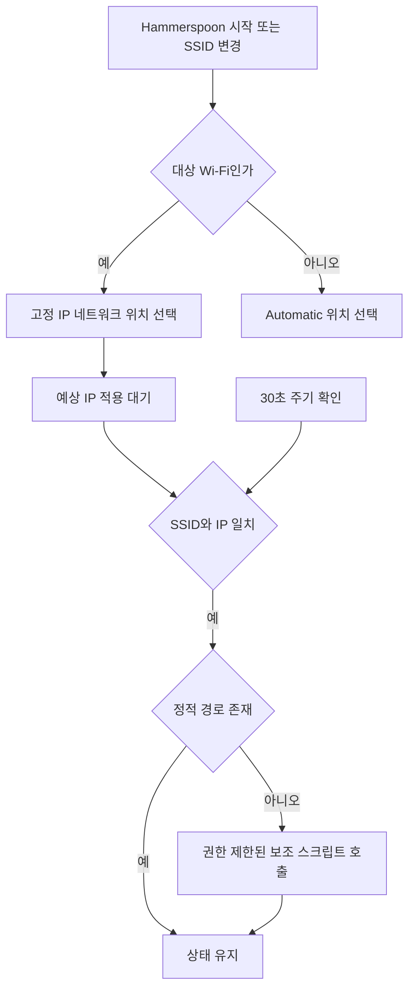

# [automation] macOS 업무망·현장망 네트워크 설정 자동 전환

업무망과 현장망을 오가며 Wi-Fi에 맞춰 고정 IP, 서브넷 마스크, 게이트웨이와 정적 경로를 수동으로 바꾸던 작업을 Hammerspoon으로 자동화했다. 실제 사용 중인 설정과 연결된 셸 스크립트를 공개용으로 정리했다.

## 작업 배경

Windows에서는 추가 NIC나 Wi-Fi 동글을 활용해 여러 네트워크에 접근하며 작업했다. 당시 사용한 Mac 환경에서는 같은 방식의 장비 확장이 어려워 Wi-Fi를 변경할 때마다 네트워크 설정을 직접 전환해야 했다. 장비·드라이버 환경의 제약을 설명한 것이며 모든 Mac에서 Wi-Fi 동글을 사용할 수 없다는 의미는 아니다.

연결된 Wi-Fi를 기준으로 미리 준비한 네트워크 설정과 서버망 경로를 적용하도록 구성해 반복적인 수동 설정을 줄였다.

## 공개 코드

- [Hammerspoon 설정](init.lua)
- [정적 라우팅 보조 스크립트](add-site-route)

실제 SSID, 고객사 식별 정보, IP 대역과 보조 스크립트 이름을 예시로 치환했다. 원본 설정은 변경하지 않았다. 보조 스크립트는 첫 줄에 shebang이 오도록 앞의 빈 줄만 제거했다. 동작 개선을 위한 로직 변경은 하지 않았다.

## 구현 방식

| 단계 | 동작 |
| --- | --- |
| Wi-Fi 변경 감지 | `hs.wifi.watcher`로 SSID 변경 감지 |
| 현장 Wi-Fi 접속 | `scselect`로 고정 IP가 저장된 `FieldNetwork` 위치 선택 |
| 설정 대기 | 3초 후 확인을 시작하고, 2초 간격으로 최대 10회 IP 확인 |
| 정적 경로 적용 | SSID와 예상 IP가 일치하고 경로가 없으면 보조 스크립트 호출 |
| 경로 복구 | 30초마다 SSID·IP·경로를 확인하고 누락 시 다시 추가 |
| 다른 Wi-Fi 접속 | `Automatic` 위치로 전환 |
| 로그·알림 | 위치 변경, 경로 추가와 실패를 콘솔·알림에 표시 |

IP·서브넷·기본 게이트웨이를 Lua에서 직접 입력하는 방식은 아니다. macOS 네트워크 위치에 저장한 값을 선택하고, 보조 스크립트로 별도 서버망의 정적 경로를 추가하는 구조다. `Automatic` 위치에 DHCP가 설정되어 있어야 다른 Wi-Fi에서 DHCP를 사용한다.

## 공개본의 설정 예시

| 항목 | 예시 값 |
| --- | --- |
| 대상 SSID | `Field-WiFi` |
| 고정 IP 네트워크 위치 | `FieldNetwork` |
| 일반 네트워크 위치 | `Automatic` |
| 예상 IP | `192.0.2.10` |
| 서버망 정적 경로 | `198.51.100.96/27` |
| 정적 경로 게이트웨이 | `192.0.2.1` |
| 보조 스크립트 경로 | `/usr/local/sbin/add-site-route` |
| IP 확인 인터페이스 | `en0` |

주소는 문서용 예시다. 실제 사용 시 Lua와 셸 스크립트의 값 및 경로 검사에 사용되는 문자열을 함께 변경해야 한다. 인터페이스가 `en0`인지 확인한다. SSID는 기본 Wi-Fi 인터페이스에서 읽으므로 IP 확인 대상과 같은 인터페이스인지도 확인한다.

## 적용 준비

1. Hammerspoon을 설치하고 Wi-Fi 정보 접근에 필요한 권한 상태를 확인한다.
2. macOS에 고정 IP용 네트워크 위치와 일반 네트워크 위치를 준비한다. 각 위치에 IP·서브넷·게이트웨이와 필요 시 DNS를 설정한다.
3. 보조 스크립트의 대상 대역·게이트웨이를 확인한다.
4. 보조 스크립트를 관리자 소유로 배치하고 일반 사용자가 파일 또는 상위 경로를 바꿀 수 없는지 확인한다.
5. Hammerspoon은 `sudo -n`으로 정확한 보조 스크립트만 호출한다. 별도 권한 설정이 없다면 해당 단계는 실패한다. 허용할 경우 사용자·실행 파일·인자를 제한하고 임의 명령이나 편집 가능한 스크립트를 포괄 허용하지 않는다.
6. 기존 `init.lua`를 백업하고 다른 자동화와 병합한 뒤 설정을 다시 읽는다.

원본 기기의 sudoers 설정은 확인·복사하지 않았으며 공개본만으로 권한 구성이 완료되지는 않는다. 이 저장소에 등록하는 과정에서는 네트워크 위치나 권한 설정을 변경하지 않았다.

## 코드에서 처리하는 예외

- 이미 선택한 위치면 불필요한 위치 변경을 건너뛴다.
- SSID를 읽지 못하면 해당 콜백에서 위치를 전환하지 않는다.
- 새로운 Wi-Fi 전환 시 기존 대기 타이머를 중지하고 세대 번호로 이전 작업의 진행을 막는다.
- 경로 추가 작업의 중복 실행을 막는다.
- 셸 스크립트에서 같은 목적지의 다른 경로를 찾으면 임의 삭제 대신 오류를 반환한다.

## 알려진 제약

- 현재 구현은 대상 SSID 하나와 일반 위치 하나를 구분한다. 여러 현장 프로필을 순회하는 구현은 아니다.
- 고정 IP 문자열을 확인하며 서브넷, 기본 게이트웨이와 DNS를 각각 검증하지 않는다.
- 비대상 Wi-Fi로 바뀔 때 정적 경로를 명시적으로 삭제하지 않는다. 위치 변경 뒤 경로 상태를 별도로 확인해야 한다.
- Lua는 경로 목적지의 CIDR 및 주소 표기를 모두 검사하지만 보조 스크립트는 CIDR 표기만 검사한다. 출력 표기에 따라 셸의 사전 검사가 다르게 동작할 수 있다.
- SSID만으로 신뢰할 수 있는 네트워크임을 인증하는 기능은 아니다.
- Wi-Fi 미연결·절전 복귀 등의 전체 예외를 새로 재현한 것은 아니다.

## 결과와 검증 범위

실제 업무 환경에서 사용 중인 자동화로, Wi-Fi 변화에 따라 저장된 고정 IP 설정과 정적 경로를 적용하도록 구성했다. 이번 공개본은 원본의 코드 구조, 네트워크 위치 이름 목록과 보조 스크립트 존재·파일 소유권을 읽기 방식으로 확인한 뒤 작성했다.

등록 과정에서 원본 자동화를 실행하거나 Wi-Fi·IP·라우팅을 변경하지 않았다. 공개본 보조 스크립트는 `sh -n` 구문 검사를 수행했다. 별도 Lua 인터프리터가 없어 Lua 구문 검사와 Hammerspoon 실행 검증은 수행하지 않았다. 소요 시간 단축이나 장애 감소를 수치로 주장하지 않는다.

별도 재현 시 대상 SSID 접속, 일반 Wi-Fi 복귀, IP 적용 지연, 경로 누락 후 복구, 같은 대역의 다른 경로가 존재하는 경우를 확인한다.

## 참고

- [Hammerspoon Wi-Fi watcher](https://www.hammerspoon.org/docs/hs.wifi.watcher.html)
- [현재 Wi-Fi 조회](https://www.hammerspoon.org/docs/hs.wifi.html#currentNetwork)

[공개 작업 목록으로](../README.md)
