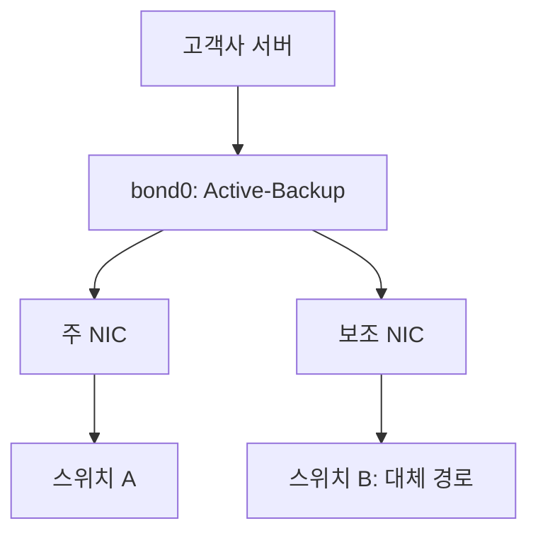
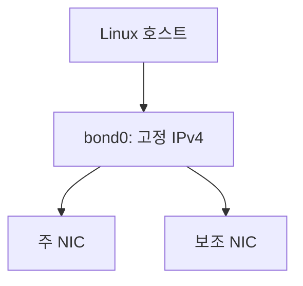

# [network] Netplan 기반 NIC Active-Backup 본딩 스크립트

국내 대형 온라인 서점 Y사의 실제 고객사 서버에 NIC 본딩을 설정한 작업을 정리했다. 두 물리 NIC를 선택해 `bond0`을 구성하는 Bash 스크립트를 함께 공개한다.

## 실제 적용 배경과 담당 작업

고객사 시스템의 고가용성을 확보하고 무중단 서비스 운영을 지원하기 위해 RoseMirror 구성과 스위치 이중화를 진행하는 과정에서, 각 서버에 NIC 본딩을 설정했다.

서버의 네트워크 경로도 이중화해 한쪽 스위치에 장애가 발생하더라도 대체 스위치를 통한 통신 경로로 작업을 이어갈 수 있도록 하는 것이 목적이었다. 이 문서는 그중 서버별 NIC 본딩 설정 작업을 다룬다.

- 적용 대상: 국내 대형 온라인 서점 Y사의 실제 고객사 서버
- 작업 범위: 서버별 NIC 본딩 설정
- 구성 방식: Active-Backup
- 적용 목적: 스위치 장애에 대비한 대체 네트워크 경로 확보
- 공개 결과물: 설정에 사용한 스크립트의 주소 정보를 공개용 예시로 치환한 파일

## 네트워크 구성 목적



각 서버의 두 NIC를 서로 다른 스위치 경로에 연결하는 구성 목적을 설명한 개념도다. 실제 고객사 서버명, 주소, 스위치 모델과 세부 네트워크 토폴로지는 공개하지 않는다. RoseMirror 설정 원본과 상세 구성도는 이 자료에 포함하지 않는다.

[스크립트 보기](setup-bond_v4.sh)

## 구성

- Netplan의 renderer를 NetworkManager로 지정한다.
- 주 NIC와 보조 NIC를 선택하고 고정 IPv4, 서브넷, 게이트웨이, 선택 사항인 DNS를 입력한다.
- `active-backup` 모드와 주 NIC를 지정한다.
- 링크 감시 간격은 100ms, up/down 지연은 각각 200ms로 설정한다. 이 값은 실제 장애 전환 시간의 측정 결과가 아니다.
- `primary-reselect-policy: failure`를 지정한다.
- 보호 대역의 IPv4를 가진 물리 NIC는 본딩 선택 대상에서 제외하고 기존 설정 보존을 시도한다.



구성 개념도이며 실제 케이블, 스위치 및 무선 연결 토폴로지는 포함하지 않는다.

## 실행 환경과 준비

Linux, Bash 4 이상, Netplan, NetworkManager, iproute2 및 GNU 기본 도구가 필요하다. 루트 권한이 필요하며 일반 사용자로 실행하면 sudo로 다시 실행한다. 실행 대상 OS와 Netplan 버전의 호환성은 별도로 확인해야 한다.

공개본의 주소는 문서용 예시로 교체했다. 실행 전 `PROTECTED_IP_REGEX`를 보존할 실제 관리망에 맞게 수정해야 한다. 예시 주소를 실제 운영 주소로 사용하지 않는다.

## 사용 방법

기존 설정을 별도로 백업하고 로컬 콘솔 또는 별도의 복구 경로를 확보한 환경에서 실행한다. 기존 네트워크 설정을 변경하므로 원격 접속이 끊길 수 있다.

```bash
bash -n setup-bond_v4.sh
sudo bash setup-bond_v4.sh
```

1. 본딩할 서로 다른 NIC 두 개를 선택한다.
2. 주소, 서브넷, 게이트웨이와 필요 시 DNS를 입력한다.
3. 적용 요약을 확인하고 기존 Netplan 설정 교체에 동의한다.

## 설정 변경과 검증 범위

기존 `/etc/netplan`의 YAML 파일을 `backup-타임스탬프` 하위 폴더로 옮기고 `99-bond0.yaml`을 생성한다. 선택한 NIC와 보호 대상으로 분류된 NIC 외의 기존 설정은 새 파일에 포함하지 않는다. 브리지, VLAN, 기존 Wi-Fi 및 다른 NIC 설정이 있는 호스트는 적용 전에 검토해야 한다.

보호 NIC의 Netplan 설정을 읽지 못하면 현재 IPv4 주소만 보존하도록 작성되어 있다. 이 경우 경로, DNS, DHCP 등 전체 설정 보존을 보장하지 않는다.

스크립트는 `netplan generate`, `netplan apply` 후 bond0의 존재, IPv4, 기본 경로와 보호 NIC의 IPv4 유지 여부를 검사한다. 해당 단계가 실패하면 기존 설정 복원을 시도한다. 모든 예상치 못한 중단을 자동 복구하는 구조는 아니다. 게이트웨이 ping 실패는 경고만 출력한다.

## 실제 적용과 공개본 검증 범위

NIC 본딩 설정은 실제 고객사 서버에서 수행한 작업이다. 이 저장소에는 공개 가능한 스크립트와 작업 설명을 정리했다.

공개본을 저장소에 추가하는 과정에서는 코드와 Bash 구문을 확인했으며, 고객사 환경을 다시 구성하거나 스위치 장애 전환을 재시험하지 않았다. 당시 장애 시험의 원본 로그와 정량 결과는 이 저장소에 포함되어 있지 않다.

별도 재현 시 확인할 항목:

- 주 NIC 링크 단절 시 보조 NIC 전환 및 통신 상태
- 주 NIC 복구 후 활성 NIC 선택 동작
- 기존 세션과 원격 접속에 미치는 영향
- 보호 NIC의 주소 외 경로와 DNS 유지 여부
- 적용 실패 시 설정 복원과 통신 복구

무중단 서비스는 전체 고가용성 구성의 구축 목적이다. 이 문서에서는 NIC 본딩만으로 무중단을 보장하거나 전환 시간·패킷 손실을 측정한 성과를 주장하지 않는다.

[작업 목록으로](../README.md)
