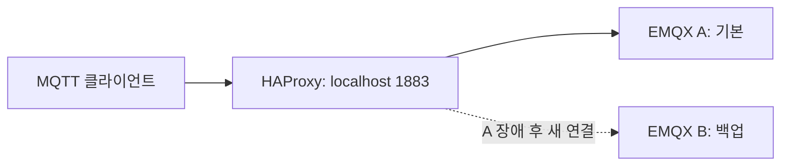

# macOS에서 MQTT 공유 구독과 브로커 전환 확인

과거 작업을 참고해 새로 만든 재현 실습이다. EMQX 5.0.26 두 대는 서로 독립적이며 클러스터를 구성하지 않는다. HAProxy는 A를 기본 브로커, B를 백업 브로커로 사용한다. 이 `backup` 설정은 이번 재현을 위한 선택이며 과거 설정을 복원한 것이 아니다.

## 검증 범위

1. 동일 브로커의 같은 공유 구독 그룹에서 메시지 수신을 분담하는지 확인한다.
2. 독립 브로커 B에는 A에 발행한 메시지가 전달되지 않는지 확인한다.
3. A 중지 후 HAProxy로 접속한 클라이언트가 B로 재연결하는지 확인한다.

Mac의 `127.0.0.1:1883`은 고정된 실습 접속점이다. Keepalived로 이동하는 VIP가 아니다. Docker Desktop의 호스트 네트워킹은 레이어 4 방식이므로 이 실습은 LAN의 VRRP/VIP 전환 검증을 대체하지 않는다. Keepalived 전환은 Linux VM 두 대 등 별도 환경에서 검증해야 한다.



## 시작

Docker Desktop을 실행한 뒤 이 폴더에서 실행한다. EMQX 5.0 계열을 재현하기 위한 로컬 실습이며 운영 배포용 구성은 아니다. 포트는 Mac의 루프백에만 공개하며 MQTT 인증 및 TLS는 구성하지 않았다.

```bash
docker compose --profile tools pull
docker compose up -d --wait
```

| 대상 | Mac에서 접속 | Compose 내부 |
| --- | --- | --- |
| A MQTT | localhost:18831 | broker-a:1883 |
| B MQTT | localhost:18832 | broker-b:1883 |
| HAProxy MQTT | localhost:1883 | haproxy:1883 |
| A 콘솔 | http://localhost:18083 | broker-a:18083 |
| B 콘솔 | http://localhost:18084 | broker-b:18083 |

콘솔 초기 계정은 `admin` / `public`이며 첫 로그인에서 비밀번호 변경을 요청할 수 있다. 각 콘솔의 Clients 화면에서 클라이언트 ID와 접속 수를 확인한다. HAProxy의 TCP 상태 확인 연결도 순간적으로 연결 수에 영향을 줄 수 있으므로 클라이언트 ID와 터미널 로그를 함께 확인한다.

`mqtt.sh`는 관찰 시간을 줄이기 위해 MQTT Keep Alive를 5초로 지정한다. 이는 Keepalived 소프트웨어와 별개의 MQTT 연결 감시 설정이다. HAProxy의 client/server 비활성 타임아웃은 15초로 지정했다. 장애 직전의 재연결이 응답 없는 연결에 걸렸을 때 대기 시간이 길어지는 것을 제한하기 위한 실습 설정이며, 운영 환경에서는 Keep Alive와 함께 조정해야 한다.

## 1. 공유 구독과 독립 브로커 확인

터미널 네 개를 열고 모두 이 폴더로 이동한다. 각 명령의 `-i`는 서로 다른 클라이언트 ID다. `$share`가 셸 변수로 해석되지 않도록 작은따옴표를 유지한다.

터미널 1 — A의 첫 구독자:

```bash
bash mqtt.sh a sub -i a-worker-1 -t '$share/workers/lab/jobs' -q 1 -v -d
```

터미널 2 — A의 두 번째 구독자:

```bash
bash mqtt.sh a sub -i a-worker-2 -t '$share/workers/lab/jobs' -q 1 -v -d
```

터미널 3 — 독립 브로커 B의 구독자:

```bash
bash mqtt.sh b sub -i b-worker-1 -t '$share/workers/lab/jobs' -q 1 -v -d
```

세 구독자의 SUBACK을 확인한 뒤 터미널 4에서 A로 발행한다:

```bash
printf 'job-01\njob-02\njob-03\njob-04\njob-05\njob-06\n' | \
  bash mqtt.sh a pub -i publisher-a -t lab/jobs -q 1 -l
```

관찰할 내용: A의 두 구독자 사이에서 수신을 분담하고, B에는 A의 메시지가 도착하지 않는지 확인한다. 정확한 3:3 분배나 QoS 1의 중복 없는 처리를 보장하는 시험은 아니다.

터미널 4에서 B로 발행하면 B의 구독자만 수신하는지도 확인한다:

```bash
bash mqtt.sh b pub -i publisher-b -t lab/jobs -q 1 -m 'b-only'
```

## 2. HAProxy를 통한 재연결 확인

앞의 구독자 세 개를 Ctrl+C로 종료한다. 아래 구독자를 터미널 1에서 실행한다:

```bash
bash mqtt.sh proxy sub -i failover-worker -t '$share/workers/lab/jobs' -q 1 -v -d
```

터미널 2에서 발행하고 A 콘솔에 `failover-worker`가 있는지 확인한다:

```bash
bash mqtt.sh proxy pub -i before-stop -t lab/jobs -q 1 -m 'before-A-stop'
docker compose stop broker-a
```

구독자의 연결 종료·재연결·SUBACK 로그와 B 콘솔의 `failover-worker`를 확인한다. 그 후 새 메시지를 발행한다:

```bash
bash mqtt.sh proxy pub -i after-stop -t lab/jobs -q 1 -m 'after-A-stop'
```

이는 기존 TCP 연결의 이동이 아니라 끊어진 클라이언트의 재연결이다. 장애 직후에는 연결 실패나 메시지 누락이 발생할 수 있다. 이 절차는 브로커 간 세션 복제나 메시지 보존을 검증하지 않는다.

### A 복구 시 주의

```bash
docker compose start broker-a
```

A가 다시 정상으로 판정되면 새 연결은 A로 향하지만 이미 B에 연결된 구독자는 B에 남을 수 있다. 이때 새 발행자는 A, 기존 구독자는 B로 분리되어 메시지가 전달되지 않을 수 있다. 자동 복귀로 인한 이 문제를 관찰한 뒤 구독자를 Ctrl+C로 종료하고 다시 실행해 접속 대상을 맞춘다. 운영 구성에서는 별도의 복귀 정책과 상태 공유 설계가 필요하다.

## 결과 기록

실행 환경과 실제 관찰 결과는 [테스트 기록](results.md)에 정리한다. 예상 동작과 실제 결과를 구분한다.

## 종료

구독자를 Ctrl+C로 종료한 뒤 실행한다:

```bash
docker compose down
```

이 구성에는 데이터 볼륨이 없으므로 컨테이너 삭제 시 콘솔 설정과 브로커 데이터도 삭제된다.

## 참고

- [EMQX 5.0.26 소스](https://github.com/emqx/emqx/tree/v5.0.26)
- [EMQX 공유 구독](https://docs.emqx.com/en/emqx/latest/messaging/mqtt-shared-subscription.html)
- [Docker Desktop 호스트 네트워킹](https://docs.docker.com/engine/network/drivers/host/)

[Docker 문서 목록으로](../README.md)
